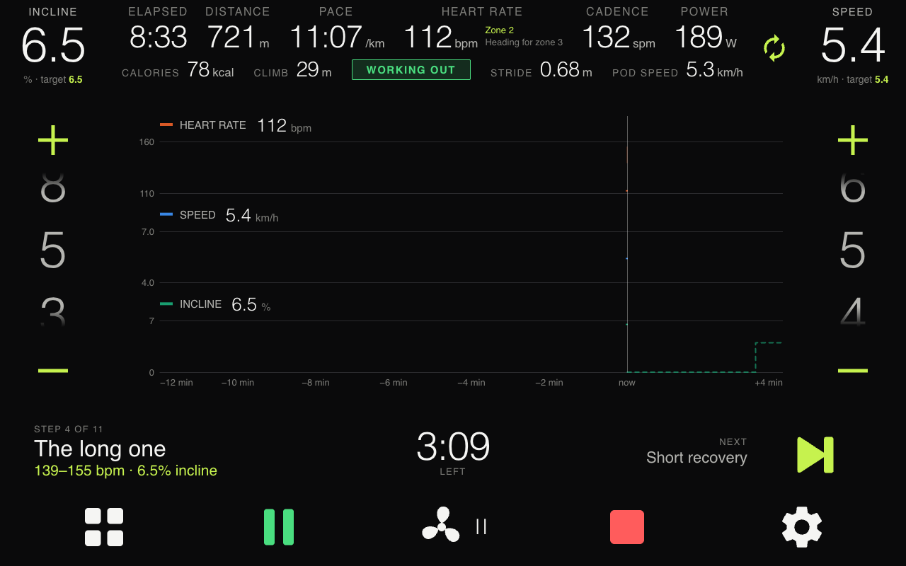
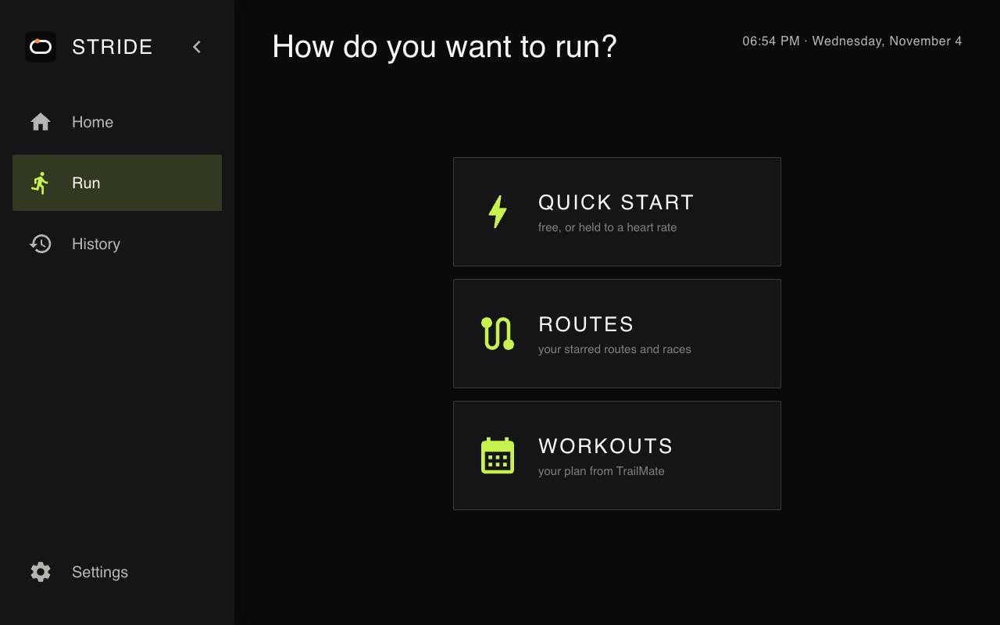
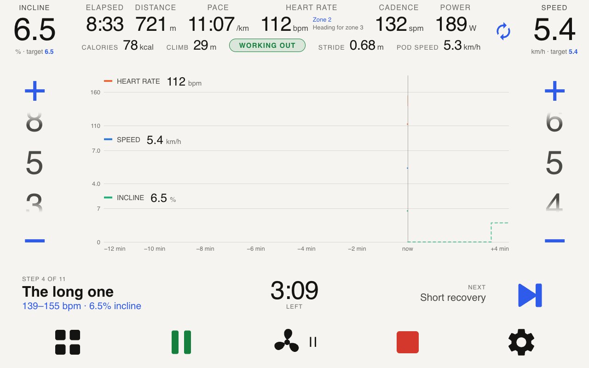
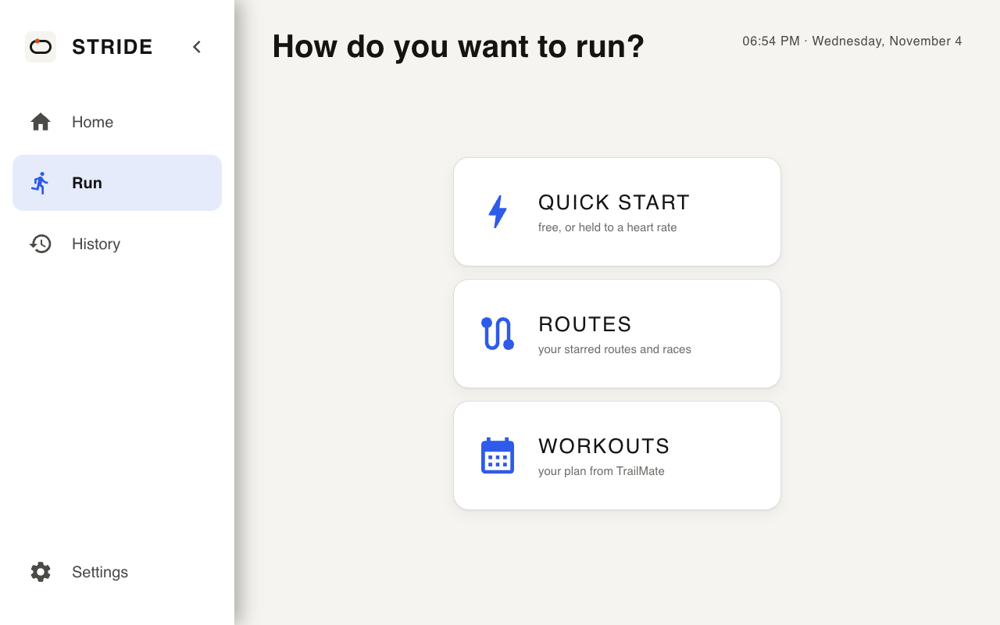
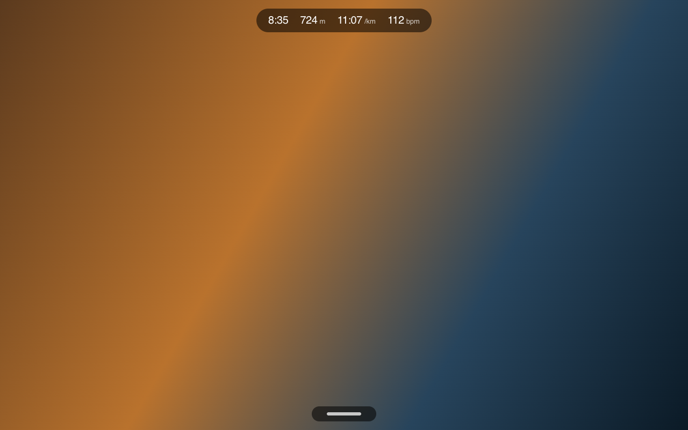

# Screenshots

1280×800, straight off the console. Mocked-up numbers, made-up names.

## A manual run

A 400 m oval, lap count in the middle, in the TrailMate app's design: deep
teal, mountain green and copper, square corners, no glow.

## A planned run

The oval is replaced by the ground ahead — the profile, where you are on it,
and the next segment. On a route STRIDE moves the incline; on a TrailMate
workout it also sets the belt speed, by pace or by heart rate. (Screenshot from
before workouts came from TrailMate.)

## Two minimal looks

Carbon and Paper, beside TrailMate: each a whole theme, chosen from a desktop
as a profile's `theme.base` ([REMOTE.md](REMOTE.md)). These five are from a
browser at the console's size (`?theme=carbon`), not off a console.

**Carbon.** Near-black, light figures, square corners, one lime to touch.

**Paper.** Off-white with soft white cards, for a bright room.

## Over a film, at a glance

With the numbers and the controls both put away over another app, the top
grip carries time, distance, pace and heart rate. A tap brings the rest back.
(The picture behind is a stand-in for the film.)

## Settings

On the treadmill's own screen. No config files, no rebuild.

### People
Everyone gets their own totals, history and TrailMate link.

### Heart rate
Bluetooth chest straps, using the standard heart rate service — the scan
filters on service UUID, not brand, so most straps work.

### Display
Kilometres or miles, and everything that comes with living with a screen
that's on all day. Units change every screen and everything published; the
board stays metric underneath either way.

### About
The board line is read over USB at startup.

## Welcome

Nobody is set up out of the box, so it offers a guest run until you add
people.

